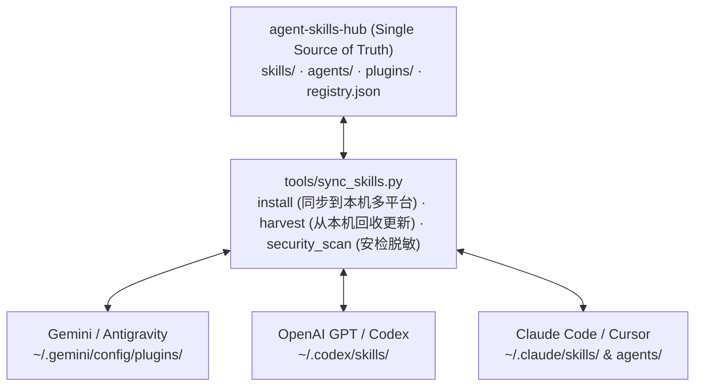

# Agent Skills Hub (`agent-skills-hub`)

> **跨智能体公开技能与子代理统一管理仓库** — 遵循开放的 **Agent Skills** 目录规范（`SKILL.md` + `scripts/` + `references/` + `examples/`），实现 **一次编写、多端同步、全平台复用**。
>
> 原生兼容：**Google Gemini / Antigravity** · **OpenAI GPT / Codex** · **Claude Code** · **Cursor** 及后续任意支持 Markdown Skill 规范的 AI 编程智能体。

---

## 1. 设计理念：单一事实源 + 多平台自动装配



- **单一事实源（Single Source of Truth）**：所有技能统一维护在 `skills/<name>/`，子代理角色统一维护在 `agents/<name>.md`，跨平台元信息统一登记在 [registry.json](./registry.json)。
- **双向同步**：
  - `install`：从本仓库一键装配到本机 Antigravity / Codex / Claude 等各智能体目录；
  - `harvest`：当你在 GPT/Codex、Gemini/Antigravity 或 Claude 中打磨出新技能或更新了现有技能，一条命令即可回收同步回本仓库并自动刷新 `registry.json`。
- **公开安全门禁**：推送前自动执行 [tools/security_scan.py](./tools/security_scan.py)，拦截个人绝对路径、内网 IP、Token、私钥或测试密码，保障 Public 仓库长期安全洁净。

---

## 2. 已收录技能与子代理清单

| 名称 | 类型 | 版本 | 来源生态 | 兼容平台 | 核心能力与说明 |
| :--- | :---: | :---: | :---: | :--- | :--- |
| **[release-material-packager](./skills/release-material-packager/SKILL.md)** | Skill + Plugin | `1.0.0` | Gemini / Antigravity | Antigravity · Codex/GPT · Claude · Cursor | 版本研发完成后的端到端材料固化：撰写多模块图文技术白皮书、MD5 去重归档原始测试输入与 H.264 案例视频、Playwright+ffmpeg 自动录制 720p H.264 交互演示、零断链/编码质检门禁、Git 打标与多远端同步 |
| **[release-packager](./agents/release-packager.md)** | Subagent | `1.0.0` | Gemini / Antigravity | Antigravity · Claude Code | 基于上述技能的自主打包交付子代理，支持独立上下文全流程执行 |

> 详细目录与结构化字段见 [registry.json](./registry.json)。

---

## 3. 快速上手（Quick Start）

```bash
# 1. 克隆本公开仓库
git clone https://github.com/xuarehere/agent-skills-hub.git
cd agent-skills-hub

# 2. 查看当前收录的全部技能与本机安装状态
python tools/sync_skills.py list

# 3. 一键安装同步到本机指定智能体（支持 antigravity | codex | claude | all）
python tools/sync_skills.py install --target antigravity
python tools/sync_skills.py install --target codex
# 或一次性同步全部本机已安装的智能体平台：
python tools/sync_skills.py install --target all
```

### 从 GPT / Gemini / Claude 回收新技能并推送到本仓库

```bash
# 从 OpenAI Codex / GPT 回收更新的技能到仓库
python tools/sync_skills.py harvest --source codex --name <skill-name>

# 从 Antigravity / Gemini 回收更新的技能到仓库
python tools/sync_skills.py harvest --source antigravity --name <skill-name>

# 推送前执行公开安全扫描（必须 0 告警）
python tools/security_scan.py --root .

# 提交并推送至 GitHub
git add .
git commit -m "feat(skills): sync <skill-name> from <source>"
git push origin main
```

---

## 4. 各智能体平台适配文档

- **Google Gemini / Antigravity**：[adapters/antigravity-gemini.md](./adapters/antigravity-gemini.md)
- **OpenAI GPT / Codex**：[adapters/codex-gpt.md](./adapters/codex-gpt.md)
- **Claude Code / Cursor**：[adapters/claude-cursor.md](./adapters/claude-cursor.md)
- **新技能收录与脱敏规范**：[CONTRIBUTING.md](./CONTRIBUTING.md)

---

## 5. License

本项目基于 [MIT License](./LICENSE) 开源，欢迎自由复用、改进与跨平台同步。
